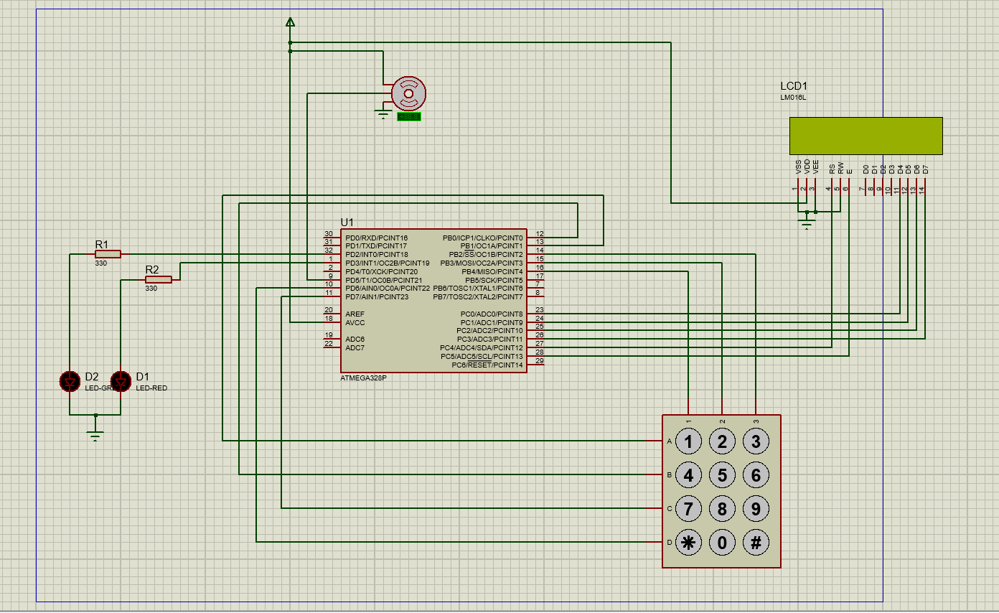

# ATmega328P Smart Lock (Bare-Metal AVR Assembly)

> A password-based smart lock written entirely in AVR assembly: no C, no Arduino libraries. Every peripheral (LCD, keypad, EEPROM, servo PWM) is driven directly through its registers.



**Course:** *(course code)*, University of Peradeniya · **Duration:** Dec 2025 – Apr 2026

**MCU:** ATmega328P · **Language:** AVR Assembly · **Tools:** Microchip Studio, Proteus

---

## Why assembly?
A keypad lock is a classic embedded project. The point here was to learn how the microcontroller really works by writing everything at register level: port direction and pull-ups, timer waveform modes, the EEPROM write sequence, LCD nibble timing, and keypad matrix scanning. Nothing is hidden behind a library.

## Features
- **Multi-user access:** up to 9 users, each with a 4-digit PIN, stored in on-chip **EEPROM** so they survive power loss.
- **Admin mode** (protected by an admin PIN): register users, delete users, or wipe all users.
- **Servo-driven bolt** using hardware **PWM** from Timer0.
- **16×2 LCD menus**, with PIN digits masked as `*`.
- **Status LEDs:** green for access granted, red for access denied.
- **Navigation keys:** `*` = back, `#` = close the door, available from any menu.

## Menu flow
```
MAIN MENU  "1:Log 2:Admin" / "*:Back #:Close"
 ├─ 1 → User ID? → Enter pass ****
 │        ├─ match    → "Access Allowed" · servo opens · green LED (2 s)
 │        └─ mismatch → "Access Denied"  · red LED (2 s)
 ├─ 2 → Admin pass ****
 │        └─ ADMIN MENU  "1:Reg 2:Del" / "9:Reset *:Back"
 │             ├─ 1 → auto-assign next ID → enter 4-digit PIN → saved to EEPROM
 │             ├─ 2 → user ID → admin pass → slot marked empty
 │             └─ 9 → clear all users
 └─ # → close door (servo to locked position)
```

## Hardware & pin map

| Peripheral | ATmega328P pins | Notes |
|---|---|---|
| 16×2 LCD (HD44780), 4-bit mode | PC0–PC3 → D4–D7 · PC4 → RS · PC5 → E | RW tied to GND (write-only) |
| 4×3 keypad, rows | PB1 (1 2 3) · PB0 (4 5 6) · PD7 (7 8 9) · PD6 (* 0 #) | Driven LOW one row at a time |
| 4×3 keypad, columns | PB4 · PB3 · PB2 | Inputs with internal pull-ups |
| Servo | PD5 / **OC0B** | Timer0 fast PWM |
| Green LED | PD2 | Through a 330 Ω resistor |
| Red LED | PD3 | Through a 330 Ω resistor |

## How it works

### Keypad driver: matrix scan + debounce
`SCAN` pulls one row LOW at a time and reads the three column inputs (`sbis PINB, n`). With the pull-ups enabled, a pressed key reads LOW. `GET_KEY` waits for a key, then **waits until it is released**, polling with a short delay. This debounces the switch and ensures each press registers exactly once.

### LCD driver: 4-bit HD44780 protocol
Each byte is sent as two nibbles (`swap` for the high nibble first) on PC0–PC3. A read-modify-write of `PORTC` preserves the RS and E bits, and E is pulsed with a `nop` to meet the enable pulse-width requirement. Strings are stored in **flash** and streamed with `lpm r24, Z+` until a null terminator.

### Servo PWM: Timer0
Timer0 runs in **fast PWM mode** (`WGM01:0 = 11`) with **non-inverting output on OC0B** (`COM0B1`) and a **/1024 prescaler**. The bolt position is set simply by writing `OCR0B`: `8` = locked, `23` = open.

### EEPROM memory map
| Address | Contents |
|---|---|
| `0x00` | Number of registered users |
| `0x01–0x04` | User 1 PIN (4 ASCII digits) |
| `0x05–0x08` | User 2 PIN |
| … | User *n* at `1 + 4·(n−1)` |
| | A first byte of `0xFF` marks an empty or deleted slot |

Writes follow the datasheet's timed sequence: wait for `EEPE` to clear, load `EEAR`/`EEDR`, set `EEMPE`, then set `EEPE`. Reads poll `EEPE` first, then strobe `EERE`.

## Challenges & what I learned
- **Switch bounce:** a single key press registered as several. → Added release detection with a delay in `GET_KEY`, so each press is accepted only once.
- **Instruction-level timing:** at full clock speed, back-to-back port operations can be too fast for external hardware. → Added a `nop` in the LCD enable pulse, and cycle-counted delays after each LCD command or character.
- **Fresh EEPROM reads `0xFF`:** on a new chip, the user-count byte reads 255, not 0. → The admin **Reset** option initialises the memory map (count = 0, all slots = `0xFF`).
- **No libraries to fall back on:** every driver (LCD, keypad, EEPROM, PWM) had to be built from the ATmega328P and HD44780 datasheets, which gave a solid understanding of register-level I/O.

## Known limitations & future work
- The **admin PIN is hard-coded** (`1234`) in firmware. A real product would store it, hashed, in EEPROM and allow it to be changed.
- **Deleting a user doesn't free the ID**, because the user count only increases. IDs are a single key (1–9), so at most 9 registrations are possible before a reset.
- Delays are software busy-loops calibrated by cycle count. Timer-based delays would be more accurate and free the CPU.
- Future work: lockout after repeated wrong PINs, a buzzer, and sleep mode for battery operation.

## Repository structure
```
├── src/smart_lock.asm                  # complete firmware
├── hardware/smart_lock_proteus.pdsprj  # Proteus simulation project
├── hardware/schematic.png
└── media/                              # photos / demo
```

## Build & simulate
1. **Assemble** with Microchip Studio (new AVR Assembler project, device **ATmega328P**), or with `avra`:
   `avra src/smart_lock.asm` (needs `m328Pdef.inc` on the include path).
2. **Simulate:** open `hardware/smart_lock_proteus.pdsprj` in Proteus, double-click the ATmega328P, set **Program File** to the generated `.hex`, and run.
3. **First use:** in the admin menu (admin PIN `1234`), press `9` to clear the EEPROM before registering users.
